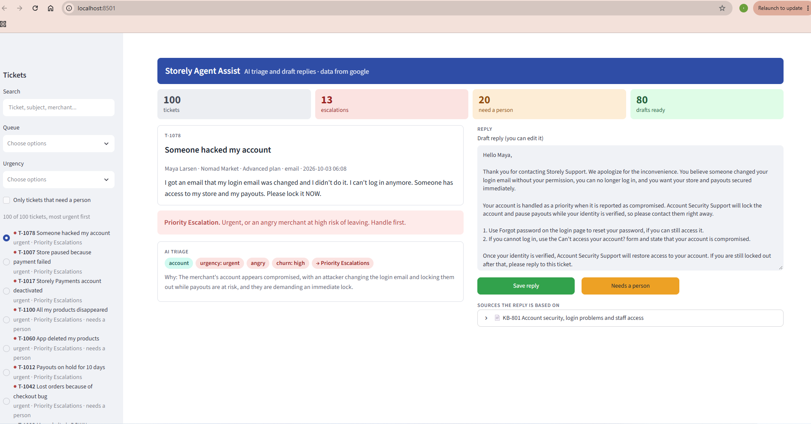
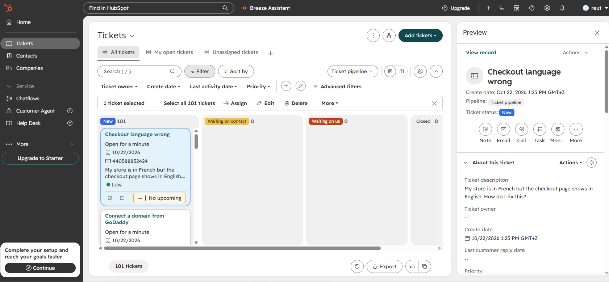
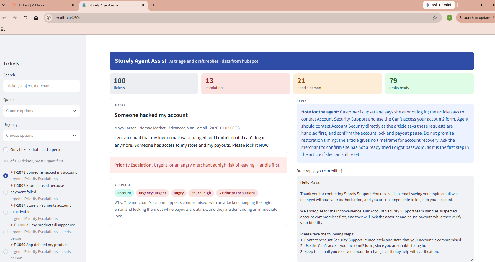

# Support AI Assistant

An AI assistant for a customer support team at a Shopify-style ecommerce store builder.

It triages incoming merchant tickets (category, urgency, sentiment, churn risk), drafts replies from the help center for human agents, and runs a customer-facing chat agent that hands off to a human with a summary when it should.

> 🚧 Work in progress. This README will be rewritten when the project is complete.

## Results so far

Claude Haiku 5.5 triaged all 100 labeled tickets for about **$0.02** per run.

| | Keyword baseline | Claude, instructions v1 | Claude, instructions v2 |
| --- | --- | --- | --- |
| Category | 62% | 99% | **99%** |
| Urgency | 51% | 66% | **70%** |
| Sentiment | 60% | 69% | **84%** |
| Churn risk | 75% | 80% | **87%** |
| Escalations caught | 9 of 12, 12 false alarms | 9 of 12, 2 false alarms | **11 of 12, 2 false alarms** |

Every miss on urgency, sentiment and churn risk is one level off. Version 2 of the instructions (`src/triage/prompt.py`) was written by reading the version 1 mistakes: clearer urgency levels, a list of anger signals, and churn rules tied to leaving or losing sales. Because it was tuned on these same 100 tickets, the fairest next check is a set of new tickets it has never seen.

Full reports with every mistake and the AI's reasoning: [version 1](evaluation/report_v1.md), [version 2](evaluation/report_v2.md).

### Replies drafted from help articles

Claude Haiku 5.5 drafted replies for all 100 tickets for about **$0.04** per run. Version 2 of the reply instructions uses a fixed, formal layout, and the code adds the "For more details, please see our help article" line and the signature, so they always match the articles actually cited.

| Check | Version 1 | Version 2 | Version 3 |
| --- | --- | --- | --- |
| Said "I don't know" on the 5 topics with no article | **5 of 5** | **5 of 5** | **5 of 5** |
| Answered tickets that an article covers | 77 of 95 (81%) | 80 of 95 (84%) | 79 of 95 (83%) |
| Answers citing an article from the ticket's correct category | 76 of 77 (99%) | 78 of 80 (98%) | 77 of 79 (97%) |

Version 3 fixed a problem found by reading the version 2 replies: one reply to a merchant ended with a sentence meant for the agent ("please check with the team before promising one to the merchant"). Notes for the agent now go in a separate private field, which the agent assist screen shows above the draft.

It never made up an answer for a topic the help center doesn't cover. Most of the 18 other handoffs are fair, because the articles really don't contain the answer (theme recommendations, sales reports, size charts). A few are overly cautious: the article covered most of the question, and a partial answer plus a handoff would have helped more. Full reports with sample replies: [version 1](evaluation/answers_report_v1.md), [version 2](evaluation/answers_report_v2.md), [version 3](evaluation/answers_report_v3.md).

## Planned features

1. **Triage engine:** tags each ticket and routes it to the right queue.
2. **Help-center answers:** answers only from the help articles and cites them.
3. **Agent assist:** a screen showing triage results and an editable draft reply.
4. **Support chat agent:** answers customers directly and hands off to a human when needed.
5. **Integrations:** HubSpot (helpdesk tickets) and Google Drive (Sheets and Docs), with local sample data as a fallback.
6. **Evaluation:** triage accuracy measured against labeled sample tickets.

## Project layout

```
data/
  tickets/          sample merchant tickets with correct labels
  help_articles/    help-center articles written for this project
src/
  triage/           ticket classification
  answer/           drafting replies from help articles
  connectors/       HubSpot, Google Drive and local-file data sources
app/                web screens (agent assist and chat)
evaluation/         accuracy tests and results
docs/screenshots/   images for this README
```

## Run it

```bash
pip install -r requirements.txt
cp .env.example .env
python -m scripts.check_connection   # reads the sample data in this repository
python -m pytest                     # runs the tests
python -m scripts.run_triage --fake  # free practice triage with a keyword-based fake AI
```

### Triage with Claude

Add your `ANTHROPIC_API_KEY` to `.env`, then:

```bash
python -m scripts.run_triage --limit 10
```

It prints the estimated cost and asks before making any API call. A `--max-cost` limit (default $0.50) stops the run if spending reaches it. With Claude Haiku 5.5, 10 tickets cost well under one cent.

The AI returns each ticket's category, urgency, sentiment and churn risk, using a fixed schema so every answer is valid. Plain business rules in `src/triage/routing.py` then pick the queue, and urgent tickets or angry merchants at risk of leaving go to **Priority Escalations**. Results are written next to each ticket in the Google Sheet, or to `data/output/triage_results.csv` locally.

### Measure accuracy

```bash
python -m scripts.run_triage --limit 100
python -m evaluation.evaluate
```

The second command is free: it compares the saved AI answers with the labels and writes `evaluation/report.md`, with scores per field, how many escalations were caught, and every mistake. For comparison, the free keyword-based fake AI (`--fake`) scores 62% on category and 51% on urgency.

### Draft replies from the help articles

```bash
python -m scripts.run_answers --fake --limit 10   # free practice run
python -m scripts.run_answers --limit 10          # real run, asks before spending
python -m scripts.run_answers --ticket T-1001     # print one full reply
python -m evaluation.evaluate_answers             # free check, writes evaluation/answers_report.md
```

This works in two steps. First, a local keyword search (`src/answer/retrieval.py`, using the BM25 ranking formula) picks the 3 help articles that best match the ticket. That step is free and keeps each AI call small. Then Claude writes a reply using only those articles and lists the article IDs it used. If none of the articles covers the question, Claude says so and the ticket is handed to a person, instead of the AI making up an answer. The code also checks every citation: an answer that cites an article Claude wasn't given is marked for review.

The reply, its sources, and whether it was answered are written next to each ticket. The evaluation checks five tickets about topics the help center deliberately doesn't cover, which should all get "I don't know".

### Agent assist screen

```bash
python -m streamlit run app/agent_assist.py
```



This opens a web page in your browser. On the left is the ticket list, sorted with escalations and the most urgent tickets first, with filters for queue, urgency and "needs a person". On the right is the selected ticket with its color-coded AI triage, the draft reply in an editable box, and the help articles it's based on. **Save reply** and **Needs a person** write the agent's version and status into their own columns (`agent_reply`, `agent_status`), so the AI's original draft is always kept for comparison. The screen only reads and saves data and never calls the AI, so it costs nothing.

To read tickets and articles from Google Drive instead, follow [docs/setup-google-drive.md](docs/setup-google-drive.md).

### Connect HubSpot

Tickets can live in HubSpot, a real helpdesk, instead of a spreadsheet. The connector reads tickets from HubSpot's API and writes the AI's triage and draft reply back onto each ticket as properties, and sets HubSpot's own priority from the AI's urgency. Setup takes a few minutes on HubSpot's free plan: [docs/setup-hubspot.md](docs/setup-hubspot.md).



With `DATA_SOURCE=hubspot`, the agent assist screen reads from HubSpot. Here it shows a private note for the agent above the draft reply:



## Data and credits

All tickets, customers and companies are fictional. Help-article topics are inspired by common questions in the public [Shopify Help Center](https://help.shopify.com), but every article is written from scratch for this project.
