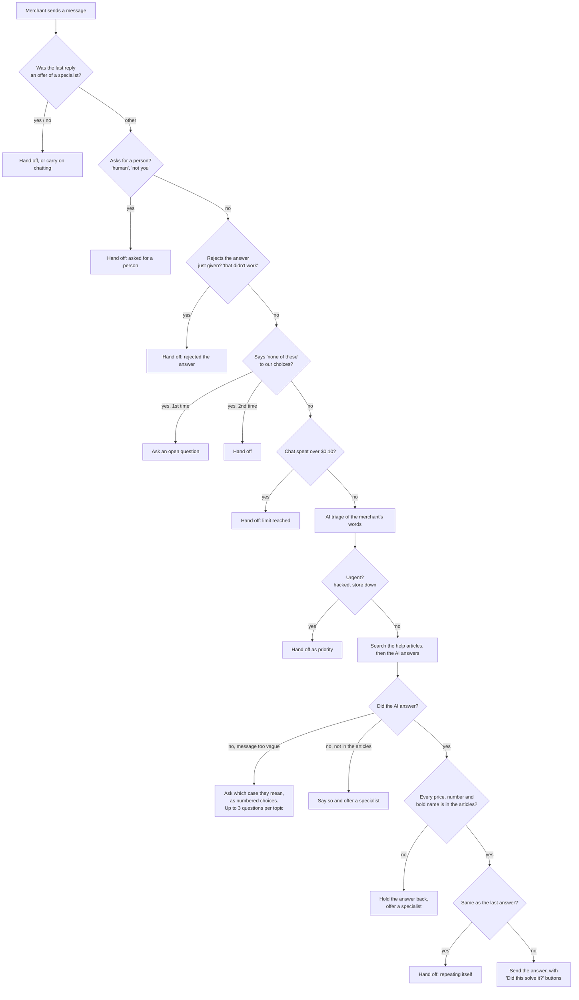

# How the support chat decides what to say

Every message the merchant sends goes through the same checks, in the same order, in
[`ChatAgent.handle()`](../src/chat/agent.py). The first check that applies decides the reply.
Most checks are plain code and cost nothing. Only two steps call the AI: triage (about $0.0002) and the answer (about $0.0006).

## Each step, with its code

| # | Check | What the merchant sees | Code |
|---|---|---|---|
| 0 | **Topic change.** The message starts with "never mind", "actually", "forget it" or "anyway". It's treated as a new question, so earlier questions and choices are forgotten. | Nothing different: the new question is answered | `TOPIC_CHANGE` |
| 0 | **Number pick.** A reply like "2" right after a list of choices means that choice. | The answer for that choice | `session.picked` |
| 1 | **Answer to our offer.** The last reply asked "Would you like me to connect you with a specialist?" | yes: hand-off. no: "No problem. Is there anything else I can help you with?" | `YES`, `NO`, `decline_offer()` |
| 2 | **Asks for a person.** For example "human", "real person", "talk to someone" or "not you". | "Of course. I have passed your conversation to a specialist…" | `ASK_FOR_PERSON` |
| 3 | **Rejects the answer just given.** For example "no", "that didn't work" or "don't lock anything". | "I understand. I have passed your conversation…" | `PUSH_BACK` |
| 4 | **"None of these"** in reply to our choices. | 1st time: an open question. 2nd time: hand-off | `NONE_OF_THESE` |
| 5 | **Spending limit.** The chat has cost $0.10. | Hand-off | `MAX_COST_PER_CHAT` |
| 6 | **Triage.** The AI reads only the merchant's words, never its own replies, and labels category, urgency, sentiment and churn risk. | Nothing. Shown in the demo panel and saved on the ticket | `_triage()` |
| 7 | **Urgent** (hacked account, store down). | "I understand this is urgent…", passed on as a priority | `ai_urgency == "urgent"` |
| 8 | **Search.** BM25 keyword search finds the 3 best help articles. It searches the latest message. A short follow-up such as "and Canada?" also uses the message before it. Questions about Storely itself go to the "What Storely offers" article. | Nothing | `_search_text()`, `ABOUT_STORELY` |
| 9 | **The AI answers** using only those 3 articles. It returns: answered yes/no, the reply, the articles it used, a private note for the agent, and, for vague messages, `needs_detail` plus choices. | — | `src/chat/prompt.py`, `ChatReply` |
| 10 | **Too vague**, for example "cant log in". | "Sorry you're having trouble logging in. What happens when you try?" followed by numbered choices. Up to 3 questions per topic, then a specialist is offered | `_clarifying_question()` |
| 11 | **Not in the articles**, for example QuickBooks or a custom plan. | "I'm afraid I don't have details on custom plans. Would you like me to connect you with a specialist?" with **Yes, connect me** and **No, thanks** buttons | `offer_person()` |
| 12 | **Fact check.** Every price, number and **bold** button or menu name in the reply must appear in the cited articles. | If not: "I want to make sure I give you accurate information on this." plus a specialist offer. The agent's note lists what was held back | `unsupported_facts()` |
| 13 | **Repeat check.** The answer is 80% or more the same as the previous one. | Hand-off. Sending the same steps twice doesn't help | `_repeats_last_answer()` |
| 14 | **Send the answer.** The layout is fixed by code: steps on their own lines, bold names, one bullet style, and the article link added. | The answer plus **Yes, that solved it** / **No, talk to a person** | `format_chat_reply()` |

## How a chat ends

Every chat becomes a ticket, in HubSpot or in `data/output/chat_tickets.csv`:

- **Solved:** the merchant clicked "Yes, that solved it". The ticket is saved as closed.
- **Handed off:** the ticket is saved as new, with the triage labels, the reason for the hand-off and the note for the agent, so the person who picks it up doesn't need to ask again.

## Practice mode vs real AI

Practice mode replaces the AI with simple word matching. It copies the best-matching article section and can't understand what a message means. It's good for clicking through the flow for free. The wording and judgement of the real chat come from the real AI.
